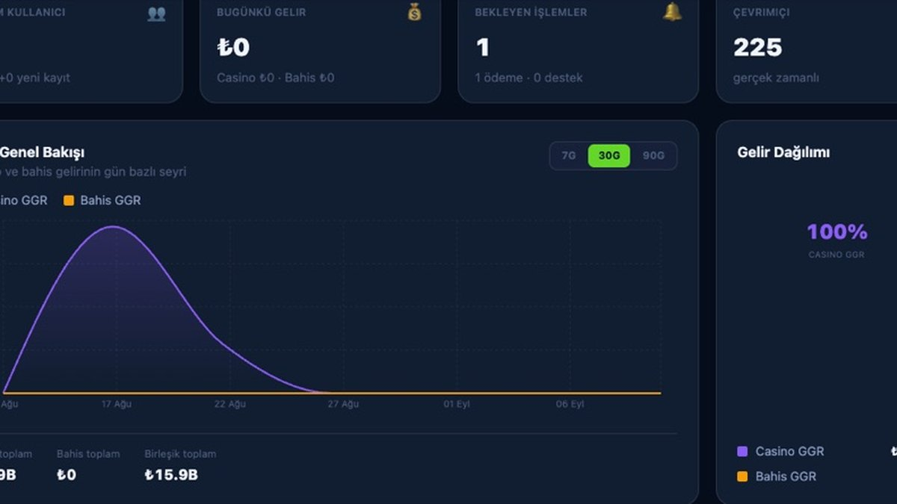
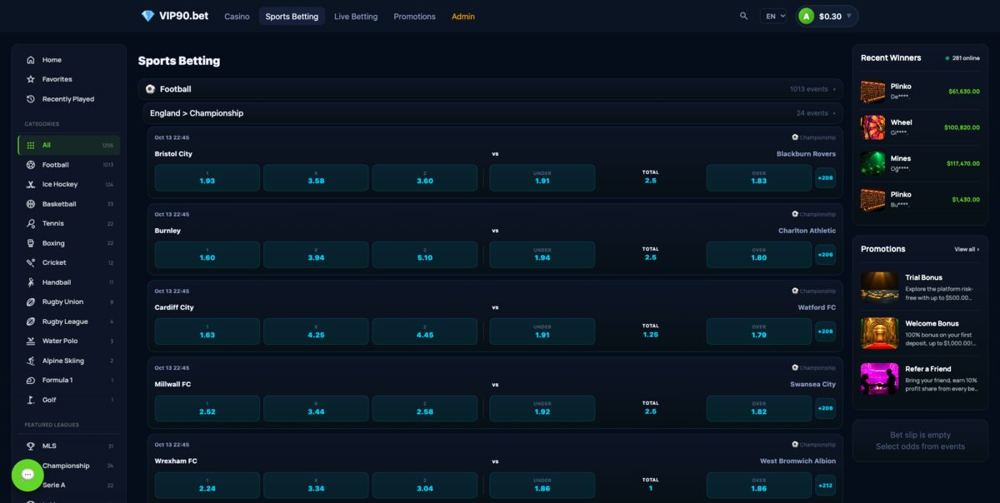
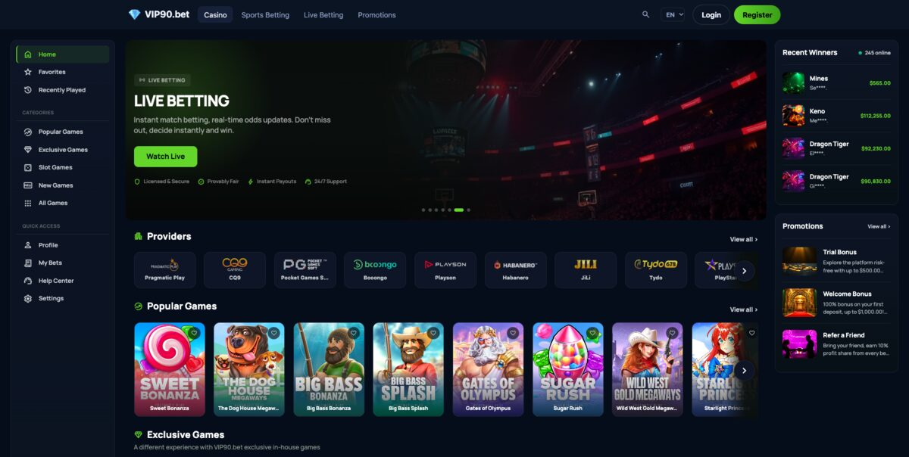
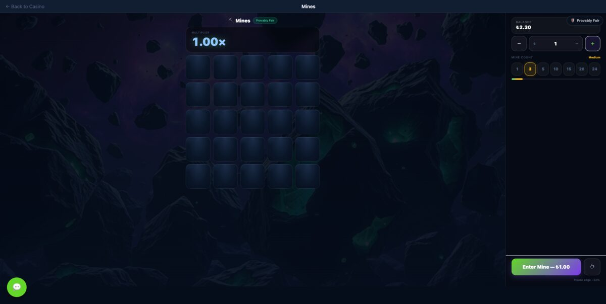

-47A248?style=flat-square&logo=mongodb&logoColor=white)


# VIP90.bet

**English** · [Türkçe](README.tr.md)

<p align="center">
  
</p>

**Self-hosted full-stack betting and casino platform with sportsbook,
live betting, casino, wallet, bonuses, affiliate and admin management.**

An online casino and sports betting platform that runs on your own
infrastructure under your own brand. The **core platform** (accounts, wallet,
bonus/wagering, KYC, risk, admin panel) is the base product and runs on its
own. **In-house Games (13 games), Sports Betting and Casino Content are
separate paid add-ons** that plug into the core: one codebase, one admin
panel. **Live Casino** (live dealer tables) is a planned future update and is
not part of this release.

Many "casino scripts" sell an empty shell wrapped in demo data that breaks the
moment you try to go live. VIP90.bet's core is the opposite: the wallet ledger,
bonus/wagering engine, risk and compliance tools, theme editor, live chat and
referral commissions are real and tested. We do not hide what is not mature
yet; see the [Roadmap](#roadmap) and [Known Limitations](docs/product/09-bilinen-kisitlar.md).

---

## Contents

- [Highlights](#highlights)
- [Screenshots](#screenshots)
- [What's Included](#whats-included)
- [Module System](#module-system)
- [Architecture and Tech Stack](#architecture-and-tech-stack)
- [Quick Start](#quick-start)
- [Security](#security)
- [Documentation](#documentation)
- [Roadmap](#roadmap)
- [Licensing](#licensing)
- [Legal notice](#legal-notice)

---

## Highlights

| | |
|---|---|
| 🛠️ **Full admin panel (core)** | Users, roles/permissions, analytics with live KPIs and revenue charts, theme/brand editor, static page and homepage slider editors, module switches, wallet (bank/crypto/Slikair), help desk, player segmentation, risk/compliance, system health monitoring |
| 💰 **End-to-end crypto payments (module)** | USDT-TRC20: HD-wallet deposit tracking, automatic or approved withdrawals from a hot wallet, transaction history in the admin panel, Web3 login with a wallet signature |
| 💳 **Slikair payment gateway (module)** | Card and alternative-method deposits; verified with sandbox credentials only, going live requires Slikair KYB |
| 🪪 **Two KYC options (module)** | Local document review (admin approve/reject queue) or automated verification with Sumsub, selectable in the panel |
| 👑 **VIP and real-time cashback** | Default 5-level VIP programme (Bronze–Diamond, editable in the panel); level-based cashback is credited right after each settled bet or round |
| 🌍 **Multi-language and PWA** | 8 language dictionaries (player screens translated in all 8; the admin panel is complete in English and Turkish, partly English in the other six) with a global language switcher, installable Progressive Web App, iOS Capacitor shell |
| 🧩 **Modular licensing** | The core is always on; Betting / Casino Content / In-house Games / Crypto Payment / Slikair / KYC / SMS Gateway are managed in the panel; the first three are separate paid add-ons |
| ✉️ **Email and SMS communication** | Event-triggered system emails and SMS, scheduled campaigns, segment targeting and delivery logs on a single **Communication** page; SMTP/Mailgun for email, Twilio for SMS |
| 💱 **Currency, brand and jurisdiction managers** | Currencies / Brands / Jurisdictions tabs under Settings; the site runs with one display currency and brand data isolation is not enforced ([Known Limitations](docs/product/09-bilinen-kisitlar.md)) |
| 🚀 **Setup wizard** | After `docker compose up -d`, open `/install` in the browser (English/Turkish) for the first admin account and site settings; a `.env` (JWT keys, database) is needed beforehand for the server to start |
| 🎰 **13 in-house games (paid add-on)** | Crash, Mines, Plinko, Dice, Limbo, Wheel, Hi-Lo, Keno, Blackjack, Roulette, Baccarat, Video Poker, Dragon Tiger; all HMAC-SHA256 **provably fair**, house edge adjustable per game in the panel |
| ⚽ **Sports and live betting (paid add-on)** | 30 sport definitions, live odds feed, single/combo bet slip, automatic settlement |
| 🃏 **Casino Content (paid add-on)** | Slots and table games through an aggregator integration (one iGaming content provider adapter today) |

## Screenshots

Real screens from a running instance (demo data, no mockups). The admin panel
and the player lobby are core; the sportsbook and the in-house game come from
the paid add-ons.

| | |
|---|---|
| **Admin — revenue dashboard**<br>Live KPIs, GGR trend, revenue split, online counter | **Sportsbook — pre-match odds**<br>1X2 and over/under markets, event counts |
|  |  |
| **Player lobby**<br>Provider row, game grid, live winners, promotions | **In-house Mines**<br>Provably-fair round with live multiplier |
|  |  |

## What's Included

### 🧱 Core platform

- Accounts, email verification, password reset; email/password, Google and
  Telegram login, and registration/login with a **Web3 wallet signature**.
- Wallet ledger (atomic, idempotent), bank transfers (admin approval queue),
  bonus/wagering engine, VIP programme, referral commissions.
- Admin: roles/permissions (RBAC), TOTP 2FA, audit log, risk engine and
  rules, reconciliation framework, responsible gaming controls, player
  segmentation, agent (reseller) system, support tickets, moderated live
  chat.
- Theme/brand/SEO settings, static pages, multi-language interface.
- Communication: editable system email and SMS templates, scheduled
  campaigns and automations, delivery logs (email via SMTP/Mailgun, SMS via
  Twilio).

### 💳 Payment and KYC modules (included with the core)

- **USDT-TRC20** crypto payments: HD-wallet deposit tracking, withdrawals
  from a hot wallet.
- **Slikair** card/alternative payment gateway (sandbox; live use requires
  KYB).
- **KYC**: local document review (approve/reject queue) or the **Sumsub**
  integration, one of them selected in the panel.

### 🎰 13 In-House Games (paid add-on)

A game library you own, with no third-party contract required:

**Crash · Mines · Plinko · Dice · Limbo · Wheel · Hi-Lo · Keno ·
Blackjack · Roulette · Baccarat · Video Poker · Dragon Tiger**

- Every round comes from an HMAC-SHA256 derivation of a `serverSeed` that is
  committed (its hash published) **before** the round, combined with a
  player-changeable `clientSeed` and a `nonce` that increases each round
  (**provably fair**). The **Fairness** panel on each game rotates the seed,
  reveals the previous one and recomputes past rounds in the browser without
  trusting the server.
- House edge and bet limits are set per game in the admin panel
  (**Products → In-house Games**): not a single abstract "RTP" field, but the
  variables that actually make up each game's maths.
- The game front end (`game-host`) is a separate application hosted on its
  own; the engine runs inside the main server process.

### ⚽ Sports Betting and Live Betting (paid add-on)

- League/country hierarchy for 30 sport definitions (football, basketball,
  tennis, ice hockey, boxing, rugby, cricket, motorsport, chess and more);
  which categories are shown is chosen under **Products → Sportsbook →
  Categories**.
- Live and upcoming events in separate feeds; per-market odds tables on the
  event page.
- Single and combo bet slip, automatic settlement engine: once an event is
  settled, the balance is credited in one atomic transaction.
- Odds data comes from the hosted VIP90 odds feed (`https://feed.vip90.bet`);
  the platform connects with an API key created in the developer portal
  (`https://developers.vip90.bet`).

### 🃏 Casino Content (paid add-on)

- Standard aggregator connector that brings a slot and table game catalogue
  into the platform. There is one iGaming content provider adapter today; a
  second provider is added by writing another adapter.
- Provider filters, favourites, recently played, search; popular games and
  bonus/freeround management in the admin panel (**Products → Casino
  Provider**).
- Live dealer **Live Casino is a planned future update**; there is no code
  for it in this release.

### 🎉 Community and retention

- Moderated live chat, "rain" bonus drops, tipping between players.
- Live wins feed (Recent Winners), favourites, recently played.
- Single-tier referral links and commissions: a percentage of the house
  profit generated by an invited user (default 10%, adjustable in the panel)
  is paid directly to the user who invited them.
- Configurable "players online" social proof layer.

### 🎨 Brand and visual identity

- Theme editor with live preview and 3 ready-made themes, logo/favicon/font
  upload (**Personalization**).
- Form-based static page and homepage slider editors (About, Careers, Press,
  Contact, etc.); there is no drag-and-drop page builder.

### 🛠️ Admin panel

Menu groups: **Overview** (Dashboard, Analytics) · **Customers** (Users,
Agents, Segments, Tickets) · **Wallet** · **Compliance** (KYC, Risk,
Reconciliation, Responsible Gaming; Audit Log) · **Products** (Casino
Provider, In-house Games, Sportsbook) · **Engagement** (Promotions, VIP,
Communication, Chat) · **Platform** (Settings: General · Modules ·
Currencies · Jurisdictions · Brands · SEO; Personalization; Roles; System
Health & Logs) · **Demo & Simulation** (Demo Data, Bots).

## Module System

VIP90.bet's core (user management, wallet, bonus/wagering engine, referral
commissions, KYC, risk, admin panel, i18n) is **always on**: it is not a
module and works fully without any add-on.

Seven modules are switched on and off in the admin panel (**Settings →
Modules**); when a license server is configured, the license state is
checked as well (`server/src/modules/registry.js`). The **Email Gateway** card
at the end of the same screen is not a module: it belongs to the core, is
always on, and is where the email provider (SMTP/Mailgun) is configured.

| Module | Provides | How it ships | Dependency |
|---|---|---|---|
| **Betting** (`betting`) | Odds feed, bet slip, automatic settlement | **Paid add-on** (`server/src/premium/betting`) | Contract with a sports data provider |
| **Casino Content** (`casino-content`) | Aggregator connector for slots/table games | **Paid add-on** (`server/src/premium/igames`) | Aggregator contract |
| **In-house Games** (`inhouse-games`) | 13 provably fair games served from a separate game server (JWT + origin protected) | **Paid add-on** (`server/src/premium/inhouse-provider`) | None, no third-party contract |
| **Crypto Payment Gateway** (`crypto-payment`) | USDT-TRC20 deposits/withdrawals | Included with the core | None |
| **Slikair Payment Gateway** (`slikair-payment`) | Card and alternative-method deposits | Included with the core; exempt from the license check | Slikair merchant account |
| **KYC Identity Verification** (`kyc-verification`) | Local document review or Sumsub | Included with the core | Third-party contract if Sumsub is chosen |
| **SMS Gateway** (`sms-gateway`) | System and campaign SMS | Included with the core | Twilio account |

The three paid add-ons live under `server/src/premium/` as **private git
submodules**; the core starts without them (optional dynamic import; their
endpoints answer `503 MODULE_NOT_INSTALLED`). While a module is switched off
its API endpoints answer `MODULE_DISABLED` and the rest of the platform keeps
working. To install the add-ons, see
[Installation § Add-on modules](docs/product/01-kurulum.md#add-on-modules-in-house-games-sports-betting-casino-content).
**Live Casino is a planned future update** and does not exist as a module
yet. Data/content provider contracts are separate from the platform: **bring
your own provider**, or ask us for an introduction to get started.

## Architecture and Tech Stack

```
client/    React 19 + Vite + Tailwind + Zustand — SPA, PWA, Capacitor (iOS)
server/    Node.js + Express + MongoDB (Mongoose) + Socket.IO
           JWT auth · Zod validation · Helmet · rate limiting
installer/ Browser-based setup wizard (/install)
deploy/    Caddy reverse proxy configuration (Docker)
server/src/premium/   Paid add-ons (private git submodules)
  inhouse-provider/   game engine + game-host/ (separate React/Vite app)
  betting/            settlement + odds feed client + sync jobs
  igames/             casino aggregator integration
```

`docker compose` runs only the `mongo`, `app` and `caddy` services;
`game-host` is **not** in Docker and is installed
separately ([Installation](docs/product/01-kurulum.md)). MongoDB must run as a
single-node replica set (multi-document transactions are used).

**Notable technical decisions:**

- **Real-time layer** over Socket.IO: odds, the online player counter, live
  chat and the wins feed are all push-based (no polling).
- **Module gate** (`moduleGate` middleware) checks the license and panel
  switch on every request and returns a consistent error contract (except
  `/api/igames`, which only checks the provider token).
- **Shared UI building blocks**: page templates (`PageWithRail`,
  `HomeSidebar`) are managed in one place, so copies cannot drift apart.
- Automated test suite covering auth, betting, wagering, the module gate and
  i18n (`npm test`).

## Quick Start

### With Docker (recommended)

```bash
cp .env.docker.example .env     # DOMAIN, JWT_SECRET, JWT_REFRESH_SECRET, CLIENT_URL, SMTP...
docker compose up -d            # mongo + app + caddy
```

Then open **`https://DOMAIN/install`** in the browser: a one-page wizard
creates the first admin account and sets the site name and currency. The
`.env` file must be filled in beforehand (sessions cannot be issued without
the JWT keys); the wizard writes the admin account, the site name/currency
and which of the Crypto/KYC modules start enabled (KYC on by default, Crypto off).

### Manual installation

```bash
npm i && npm i --prefix server && npm i --prefix client   # core dependencies
cp server/.env.example server/.env                        # fill in MONGODB_URI, JWT_*, CLIENT_URL
npm start                                                 # client build + server
```

`npm run install:all` also installs the add-on directory (`game-host`) and
skips it with a warning when the add-on is not present. MongoDB must be a replica set. Open **`/install`** while the server
is running.

To install the add-ons (In-house Games, Sports Betting, Casino Content):
[docs/product/01-kurulum.md § Add-on modules](docs/product/01-kurulum.md#add-on-modules-in-house-games-sports-betting-casino-content).

### Development

```bash
npm run dev   # client + server
```

### Tests

The recommended path (requires only Docker; no local MongoDB installation):

```bash
docker compose -f docker-compose.yml -f docker-compose.test.yml run --rm test
```

The suite typically takes a few minutes on a laptop. Alternatively, with a local MongoDB replica set on `localhost:27017`:

```bash
npm test               # unit/integration tests (server + client i18n/admin/utils); needs a local MongoDB
npm run test:network   # tests that call real external services (Slikair sandbox)
npm run test:e2e       # Playwright end-to-end tests
```

## Security

- HMAC-SHA256 **provably fair** round generation, verifiable by the player.
- JWT-based sessions, scoped tokens for embedded/casino views.
- `helmet`, `express-mongo-sanitize`, layered `express-rate-limit` (limits
  are constants in `server/src/middleware/rateLimit.js`, not env settings).
- TOTP 2FA for admins; optional IP/CIDR restriction for `/api/admin/*` with
  `ADMIN_ALLOWED_IPS`, and Cloudflare Turnstile (both off until configured).

## Documentation

- [Installation](docs/product/01-kurulum.md)
- [Architecture](docs/product/02-mimari.md)
- [API reference](docs/product/05-api-referansi.md)
- [Module system](docs/product/06-modul-sistemi.md)
- [Changelog](CHANGELOG.md)
- [Known limitations](docs/product/09-bilinen-kisitlar.md)

## Roadmap

See [CHANGELOG.md](CHANGELOG.md) and the private development notes for the
current state of paid add-ons and planned work.

## Licensing

The core is licensed under the **GNU Affero General Public License v3.0**
(AGPL-3.0). The three paid add-ons (In-house Games, Sports Betting, Casino
Content) are proprietary and distributed under a separate commercial license.

## Legal notice

This software is provided for educational and development purposes. Operating
an online gambling service is heavily regulated. Obtain appropriate licenses
in your jurisdiction before offering real-money play. The authors are not
responsible for any illegal use.

Use it to build and test your own product, or to run a licensed operation with
the right paperwork in place.

---

<sub>Built with Node.js · Express · React · MongoDB · Socket.IO.</sub>
