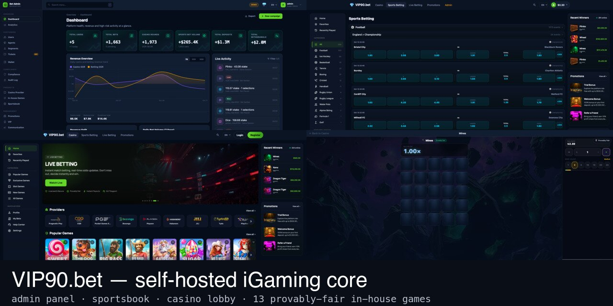

-47A248?style=flat-square&logo=mongodb&logoColor=white)


# VIP90.bet

**Türkçe** · [English](README.md)

<p align="center">
  
</p>

**Kendi altyapınızda, kendi markanızla çalışan tam yığın bahis ve casino platformu.**

Hesap, cüzdan, bonus/çevrim, KYC, risk, admin paneli çekirdek platformdur ve tek başına çalışır. **In-house Games (13 oyun), Sports Betting ve Casino Content ayrı ücretli eklentilerdir**; çekirdeğe eklenir — tek kod tabanı, tek admin panel. **Live Casino** planlanan gelecek bir güncellemedir, bu sürümde yoktur.

### Testler

Önerilen yol (yalnızca Docker gerekir; yerelde MongoDB kurulumu gerekmez):

```bash
docker compose -f docker-compose.yml -f docker-compose.test.yml run --rm test
```

Paket genellikle bir dizüstü bilgisayarda birkaç dakika sürer. Alternatif olarak, `localhost:27017` üzerinde çalışan bir MongoDB replica set ile:

```bash
npm test               # birim/entegrasyon testleri (server + client i18n/admin/utils); yerelde MongoDB ister
npm run test:network   # gerçek dış servislere giden testler (Slikair sandbox)
npm run test:e2e       # Playwright uçtan uca testleri
```

## Güvenlik

- HMAC-SHA256 **provably fair** round üretimi, oyuncu tarafında doğrulanabilir.
- JWT tabanlı oturum, gömülü/casino görünümleri için kapsamlı token'lar.
- `helmet`, `express-mongo-sanitize`, katmanlı `express-rate-limit`.

<sub>Node.js · Express · React · MongoDB · Socket.IO ile geliştirildi.</sub>
